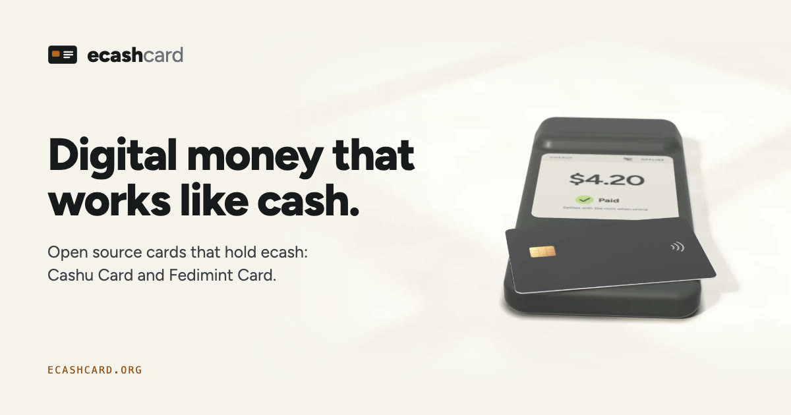

  

  <a href="https://ecashcard.org"><b>ecashcard.org</b></a> ·
  <a href="https://github.com/cashucard"><b>Cashu Card</b></a> ·
  <a href="https://github.com/fedimintcard"><b>Fedimint Card</b></a>

eCash Card is the home of two open source projects that put ecash on NFC smart cards. Like a banknote, the card belongs to whoever holds it. Anyone can pay with a tap, privately, even when the network is down.

## Three things we want to be true

- **Cash keeps its properties when it goes digital.** Ecash is a bearer token: it is spent without asking anyone, and the payer stays unnamed. A card gives it a body.
- **A card is enough.** A card costs a few dollars, works for years without a battery, and the holder carries only the card.
- **Payments work offline.** A card and a till can settle between themselves and tell the mint later.

## The projects

| Project | Where | What it is |
| --- | --- | --- |
| **Cashu Card** | [cashucard.org](https://cashucard.org) · [github.com/cashucard](https://github.com/cashucard) | An open protocol for Cashu ecash on NFC smart cards, with its JavaCard applet and tools, maintained by Flash and Foxy. |
| **Fedimint Card** | [fedimintcard.org](https://fedimintcard.org) · [github.com/fedimintcard](https://github.com/fedimintcard) | A JavaCard that holds the spend keys for Fedimint ecash notes, with its host code, till and point-of-sale app. |

This organization holds [ecashcard.org](https://github.com/ecashcard/ecashcard.org), the site.

## Status

Both projects are experimental prototypes with little outside review. Keep only small amounts on a card.

## Security

Report a vulnerability in Cashu Card or Fedimint Card privately in that project's repositories: open the affected repository's **Security** tab and choose **Report a vulnerability**. For the site, use the same tab on [ecashcard/ecashcard.org](https://github.com/ecashcard/ecashcard.org) or write to [hi@ecashcard.org](mailto:hi@ecashcard.org).
